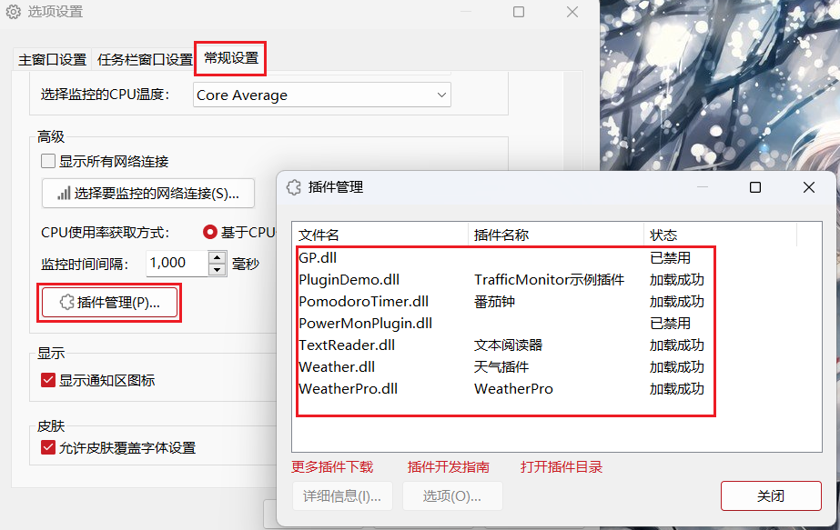
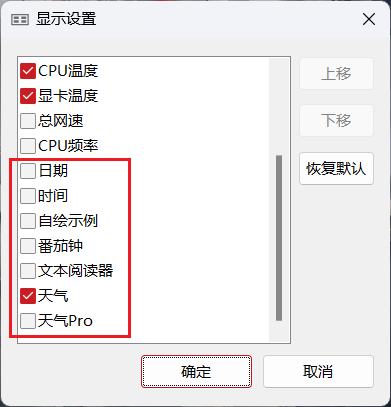

# TrafficMonitor Plugins

**English | [Русский](README.ru.md) | [简体中文](README.zh-CN.md)**

Plugins for [TrafficMonitor](https://github.com/zhongyang219/TrafficMonitor), a Windows taskbar and desktop system monitor. This repository contains plugin source code, documentation, and download links for extensions such as battery status, hardware monitoring, IP addresses, date and time, weather, and stock information.

> This is a fork of the [original TrafficMonitorPlugins repository](https://github.com/zhongyang219/TrafficMonitorPlugins). For official releases and upstream contributions, see the original project.

## Download plugins

Browse the [English plugin catalog](download/plugin_download_en.md) or [Chinese plugin catalog](download/plugin_download.md) for descriptions and download links.

## Install and enable plugins

1. Download the plugin version matching your TrafficMonitor installation: **x86 (32-bit)** or **x64 (64-bit)**, where available.
2. Extract the archive and place the plugin `.dll` in the `plugins` directory next to `TrafficMonitor.exe`. Create the directory if it does not exist.
3. Restart TrafficMonitor. Open **Options → General Settings → Plugin Manager** to see the loaded plugins.
4. To display a plugin's information in the taskbar, right-click the TrafficMonitor taskbar window, open **Display Settings**, and select the plugin items you want to show.

For more details, see the [TrafficMonitor plugin usage documentation](https://github.com/zhongyang219/TrafficMonitor/wiki/插件功能).

## Develop plugins

See the [TrafficMonitor Plugin Development Guide](https://github.com/zhongyang219/TrafficMonitor/wiki/Plugin-Development-Guide). The `Plugins/` directory contains plugin projects and a template; `PluginTester/` contains a plugin testing utility.

## Contribute

Pull requests for plugin code and documentation are welcome. When adding a plugin to the download catalog, update both [plugin_download.md](download/plugin_download.md) and [plugin_download_en.md](download/plugin_download_en.md), and add its DLL filename and latest version to [plugins_version.xml](plugins_version.xml), which TrafficMonitor uses to check for plugin updates.

To submit a plugin to the original project, follow the [upstream repository](https://github.com/zhongyang219/TrafficMonitorPlugins)'s contribution instructions.
