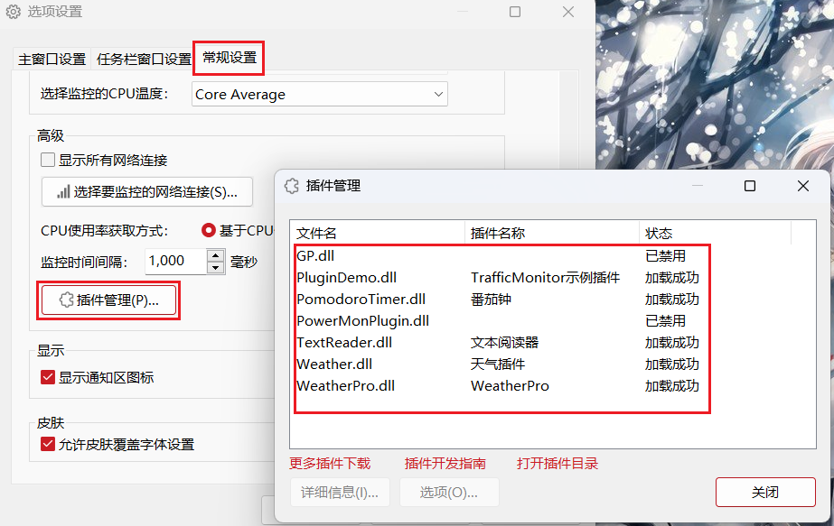
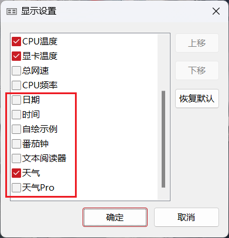

# Плагины для TrafficMonitor

**[English](README.md) | Русский | [简体中文](README.zh-CN.md)**

Плагины для [TrafficMonitor](https://github.com/zhongyang219/TrafficMonitor) — программы для мониторинга системы с отображением информации на панели задач Windows и рабочем столе. Репозиторий содержит исходный код плагинов, документацию и ссылки для скачивания расширений: состояния батареи, показателей оборудования, IP-адресов, даты и времени, погоды, биржевых котировок и других.

> Это форк [оригинального репозитория TrafficMonitorPlugins](https://github.com/zhongyang219/TrafficMonitorPlugins). Официальные релизы и правила отправки изменений в основной проект находятся в оригинальном репозитории.

## Скачать плагины

Список плагинов с описаниями и ссылками для скачивания: [на английском](download/plugin_download_en.md) или [на китайском](download/plugin_download.md).

## Установка и включение

1. Скачайте версию плагина под архитектуру установленного TrafficMonitor: **x86 (32-бит)** или **x64 (64-бит)**, если доступны обе версии.
2. Распакуйте архив и поместите файл `.dll` в каталог `plugins` рядом с `TrafficMonitor.exe`. Если каталога нет, создайте его.
3. Перезапустите TrafficMonitor. Откройте **Настройки → Общие настройки → Управление плагинами** (Options → General Settings → Plugin Manager), чтобы проверить загрузку плагина.
4. Чтобы вывести данные плагина на панель задач, щёлкните правой кнопкой мыши по окну TrafficMonitor на панели задач, откройте **Настройки отображения** (Display Settings) и включите нужные элементы плагина.

Дополнительная информация — в [документации TrafficMonitor по использованию плагинов](https://github.com/zhongyang219/TrafficMonitor/wiki/插件功能).

## Разработка плагинов

См. [руководство по разработке плагинов TrafficMonitor](https://github.com/zhongyang219/TrafficMonitor/wiki/Plugin-Development-Guide). В каталоге `Plugins/` находятся проекты плагинов и шаблон, а в `PluginTester/` — утилита для их тестирования.

## Участие в разработке

Можно отправлять pull request с изменениями кода плагинов и документации. При добавлении плагина в каталог обновите [plugin_download.md](download/plugin_download.md) и [plugin_download_en.md](download/plugin_download_en.md), а также внесите имя DLL и актуальную версию в [plugins_version.xml](plugins_version.xml) — этот файл используется TrafficMonitor для проверки обновлений плагинов.

Чтобы предложить плагин в основной проект, следуйте [инструкциям оригинального репозитория](https://github.com/zhongyang219/TrafficMonitorPlugins).
